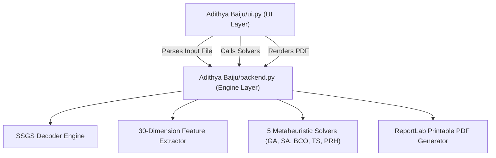

# 📁 Adithya Baiju Directory - Modular AI-RCPSP Implementation

> **Two-File Architecture**: Clean separation between **UI Interface** (`ui.py`) and **Core Backend Engine** (`backend.py`).

---

## 📂 File Architecture

| File | Type | Description |
| :--- | :--- | :--- |
| **[`ui.py`](file:///home/prak05/GITHUB/fuck%20shit/AI-RCPSP/Adithya%20Baiju/ui.py)** | **UI Layer** | Streamlit Web Interface, Plotly Gantt charts, Resource profiles, Precedence DAG, Concept Explanation Mode tooltips, and Tab controls. |
| **[`backend.py`](file:///home/prak05/GITHUB/fuck%20shit/AI-RCPSP/Adithya%20Baiju/backend.py)** | **Backend Engine** | Data models (`Project`, `Activity`, `Resource`), SSGS decoder, CPM feature extractor ($N, NC, RF, RS$), multi-format file parser (.sm, .rcp, .json), 5 metaheuristic solvers (GA, SA, BCO, TS, PRH), statistical comparison engine, and PDF report generator. |
| **[`README.md`](file:///home/prak05/GITHUB/fuck%20shit/AI-RCPSP/Adithya%20Baiju/README.md)** | **Documentation** | Documentation and presentation reference guide. |

---

## ⚡ Quick Execution Commands

### 1. Launch Streamlit Web UI (`ui.py`)

```bash
streamlit run "Adithya Baiju/ui.py"
```

*Or using the virtual environment python:*
```bash
./venv/bin/streamlit run "Adithya Baiju/ui.py"
```

### 2. Execute Backend Engine CLI Benchmark (`backend.py`)

```bash
python "Adithya Baiju/backend.py" data/j10_sample.sm
```

*Or using the virtual environment python:*
```bash
./venv/bin/python "Adithya Baiju/backend.py" data/j10_sample.sm
```

---

## 🎙️ System Architecture & Presentation Guide

### System Modularization Overview:
> 💬 **Architecture Overview:**  
> *"In the `Adithya Baiju` directory, the codebase is strictly decoupled into two single-file modules: `ui.py` handles 100% of the interactive Streamlit user interface, plotting, and layout, while `backend.py` encapsulates all data models, the SSGS decoder, feature extraction math, the 5 metaheuristic solvers, and PDF rendering."*

---

## 📊 Modules & Responsibilities Breakdown


