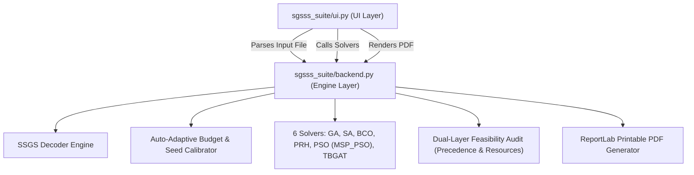

# 📁 SGSSS Suite - Modular Resource-Constrained Project Scheduling Suite (AI-RCPSP)

> **Two-File Architecture**: Clean separation between **UI Interface** (`ui.py`) and **Core Backend Engine** (`backend.py`).

---

## 📂 File Architecture

| File | Type | Description |
| :--- | :--- | :--- |
| **[`ui.py`](ui.py)** | **UI Layer** | Streamlit Web Interface, Plotly Gantt charts, Resource profiles, Precedence DAG, Concept Explanation Mode tooltips, and 7 Tab controls. |
| **[`backend.py`](backend.py)** | **Backend Engine** | Data models (`Project`, `Activity`, `Resource`), SSGS decoder, CPM lower-bound calculation, multi-format file parser (.sm, .rcp, .json) with auto-adaptive budget & seed calibration, 6 metaheuristic & neural solvers (GA, SA, BCO, PRH, PSO, TBGAT), dual-layer constraint feasibility audit, and PDF report generator. |
| **[`src/algorithms/pso.py`](src/algorithms/pso.py)** | **Solver** | Particle Swarm Optimization integrated from `henryyjiang/MSP_PSO` with cognitive/social velocity updates, inertia damping, and basin-hopping perturbations. |
| **[`src/algorithms/tbgat.py`](src/algorithms/tbgat.py)** | **Solver** | Topology-Aware Bidirectional Graph Attention Network integrated from `zcaicaros/TBGAT` with forward EST and backward LST graph attention message-passing and policy scoring. |
| **[`README.md`](README.md)** | **Documentation** | Documentation and presentation reference guide. |
| **[`EXECUTION_FLOW.md`](EXECUTION_FLOW.md)** | **Architecture Map** | Step-by-step code location trace for every system action. |

---

## ⚡ Quick Execution Commands

### 1. Launch Streamlit Web UI (`ui.py`)

```bash
streamlit run "sgsss_suite/ui.py"
```

*Or using the virtual environment python:*
```bash
./venv/bin/streamlit run "sgsss_suite/ui.py"
```

### 2. Execute Backend Engine CLI Benchmark (`backend.py`)

```bash
python "sgsss_suite/backend.py" data/j10_sample.sm
```

*Or using the virtual environment python:*
```bash
./venv/bin/python "sgsss_suite/backend.py" data/j10_sample.sm
```

### 3. Run Unit Test Suite

```bash
./venv/bin/python -m unittest tests/test_ai_rcpsp.py
```

---

## 🎙️ System Architecture & Presentation Guide

### System Modularization Overview:
> 💬 **Architecture Overview:**  
> *"In the `sgsss_suite` directory, the codebase is cleanly organized: `ui.py` handles the interactive Streamlit user interface, plotting, and layout, while `backend.py` and `src/` encapsulate the data models, the centralized SSGS decoder, auto-adaptive budget & seed calibration, the 6 metaheuristic & neural solvers (GA, SA, BCO, PRH, PSO from MSP_PSO, and TBGAT), dual-layer constraint feasibility auditing, and publication-grade PDF rendering."*

---

## 📊 Modules & Responsibilities Breakdown


